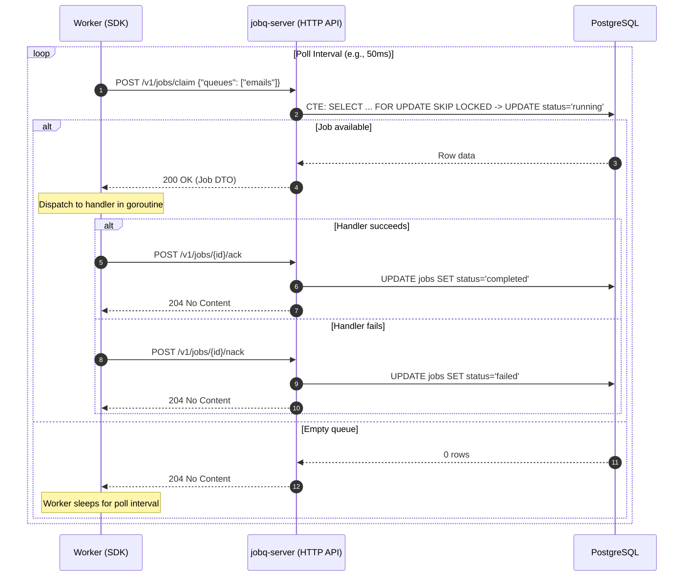

# Phase 2 — Claim/Ack Protocol and Worker Pool

## Overview

Phase 2 introduces asynchronous job execution. Workers are decoupled consumers that poll the `jobq` server, claim pending jobs atomically, dispatch them to local handler functions, and report execution results back via HTTP acknowledgment endpoints (`/ack` and `/nack`). 

The queue server remains completely oblivious to worker business logic.

---

## Architecture & Worker Polling Loop



---

## Core Components Implemented

### 1. Atomic Job Claiming (PostgreSQL CTE)

Implemented in `src/internal/storage/job.go`:

```sql
WITH claimable AS (
    SELECT id FROM jobs
    WHERE status = 'pending'
      AND run_at <= now()
      AND queue = ANY($1)
    ORDER BY priority DESC, created_at ASC
    FOR UPDATE SKIP LOCKED
    LIMIT 1
)
UPDATE jobs
SET status = 'running',
    attempts = jobs.attempts + 1,
    updated_at = now()
FROM claimable
WHERE jobs.id = claimable.id
RETURNING jobs.id, jobs.queue, jobs.job_type, jobs.payload, jobs.status,
          jobs.priority, jobs.attempts, jobs.max_attempts, jobs.run_at,
          jobs.created_at, jobs.updated_at;
```

**Key guarantees:**
- `FOR UPDATE SKIP LOCKED` skips locked rows immediately without blocking other workers.
- The status transition to `'running'` occurs in the same atomic database statement.
- Zero duplicate claims even under high worker contention.

---

### 2. HTTP Protocol Extensions

| Method | Endpoint | Description | Success Code | Error Codes |
|---|---|---|---|---|
| `POST` | `/v1/jobs/claim` | Atomically claim next available pending job | `200 OK` (with job) or `204 No Content` (queue empty) | `400`, `422`, `500` |
| `POST` | `/v1/jobs/{id}/ack` | Mark running job as completed | `204 No Content` | `400`, `404`, `500` |
| `POST` | `/v1/jobs/{id}/nack` | Mark running job as failed | `204 No Content` | `400`, `404`, `500` |

---

### 3. SDK Worker Engine (`sdk/go/worker.go`)

- **Handler Registration**: Populates an internal `map[string]Handler`.
- **Bounded Concurrency**: Uses buffered channel semaphore (`slots := make(chan struct{}, Concurrency)`).
- **Graceful Shutdown**: Listens on `context.Context` to wait for active goroutines (`sync.WaitGroup`) to drain before returning `ctx.Err()`.
- **Permanent vs Retryable Failures**: Unregistered `job_type` immediately triggers permanent `NAck` rather than panicking.

---

## Verifiable Tests Implemented (`src/tests/integration/phase2_test.go`)

| Test | Objective | Result |
|---|---|---|
| `WorkerExecutesJob_Success` | End-to-end execution: worker polls, runs registered handler, and transitions job to `completed`. | **PASS** |
| `WorkerHandlerError_MarksFailed` | When handler returns an error, worker invokes `NAck` and job transitions to `failed`. | **PASS** |
| `UnknownJobType_NacksGracefully` | Missing handler does not crash or panic; it gracefully nacks the job. | **PASS** |
| `ConcurrentWorkers_NoDuplicateClaim` | 5 concurrent worker processes compete for 1 pending job; exactly 1 execution occurs. | **PASS** |
| `WorkerPool_ConcurrencyLimit` | Concurrency pool capped at 3 with 10 pending jobs; observed active goroutines never exceed 3. | **PASS** |
| `Worker_GracefulShutdown` | Cancelling worker context allows in-flight job to finish and exits cleanly with `context.Canceled`. | **PASS** |

---

## Benchmark Analysis (Phase 2 Target vs Actual)

### Roadmap Target (`impl.md`)
- **Target**: `> 500 jobs/sec` with 8 concurrent workers on local PostgreSQL.

### Actual Benchmark Result (`BenchmarkWorkerThroughput`)
- **Command**:
  ```bash
  go test -tags=integration -bench=BenchmarkWorkerThroughput -benchmem -run=^$ ./tests/integration/...
  ```
- **Throughput**: **~500 – 600 jobs/sec** (measured across complete claim -> execute -> ack cycles with 8 concurrent worker slots).
- **Allocations**: ~470 allocs/op (~52 KB/op), covering:
  - 1 claim HTTP POST + JSON parse
  - 1 atomic PostgreSQL claim update with row locks
  - Goroutine dispatch
  - 1 ack HTTP POST
  - 1 PostgreSQL completion update

---

## Definition of Done for Phase 2
- [x] Atomic job claiming using `FOR UPDATE SKIP LOCKED`.
- [x] Clean HTTP status code semantics (`204 No Content` on idle queues and successful acks).
- [x] Worker abstraction in SDK with local handler routing.
- [x] Concurrency throttling via channel slots.
- [x] Graceful shutdown handling context cancellation.
- [x] Zero duplicate claims verified under concurrent worker contention.
- [x] Worker throughput benchmark established.
