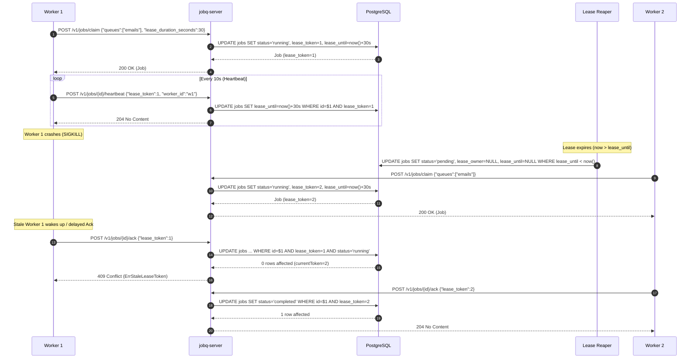

# Phase 3 — Leases, Heartbeats, and Crash Recovery

## Overview

Phase 3 implements distributed worker fault tolerance, lease management, and crash recovery. In a distributed job queue, worker processes can crash, become network-partitioned, or hang mid-execution. 

Phase 3 introduces:
1. **Time-bounded Leases**: When a worker claims a job, it is granted an exclusive lease until `lease_until`.
2. **Heartbeats**: For long-running jobs, workers periodically extend their lease via `POST /v1/jobs/{id}/heartbeat`.
3. **Background Lease Reaper**: Reclaims orphaned jobs when workers crash and their leases expire (`lease_until < now()`).
4. **Fencing Tokens**: Every claim or reclaim increments a monotonic integer (`lease_token`). All state transitions (`ack`, `nack`, `heartbeat`) enforce token matching (`WHERE id = $1 AND lease_token = $2 AND status = 'running'`). Stale workers receive `409 Conflict` and abort, preventing split-brain corruption.

---

## Architecture & Lifecycle



---

## Schema Changes

Migration `000002_lease_columns_jobs.up.sql`:

```sql
ALTER TABLE jobs ADD COLUMN lease_owner   TEXT;
ALTER TABLE jobs ADD COLUMN lease_until   TIMESTAMPTZ;
ALTER TABLE jobs ADD COLUMN lease_token   INT NOT NULL DEFAULT 0;
ALTER TABLE jobs ADD COLUMN last_error    TEXT;

CREATE INDEX idx_jobs_lease_expired ON jobs (lease_until)
    WHERE status = 'running';
```

---

## Core Components Implemented

### 1. Atomic Claiming with Fencing Token Increment

In `src/internal/storage/job.go`:

```sql
WITH claimable AS (
    SELECT id FROM jobs
    WHERE status = 'pending'
      AND run_at <= now()
      AND attempts < max_attempts
      AND queue = ANY($1)
    ORDER BY priority DESC, created_at ASC
    FOR UPDATE SKIP LOCKED
    LIMIT 1
)
UPDATE jobs
SET status = 'running',
    lease_owner = $2,
    lease_until = now() + ($3 * INTERVAL '1 second'),
    attempts = jobs.attempts + 1,
    lease_token = lease_token + 1,
    updated_at = now()
FROM claimable
WHERE jobs.id = claimable.id
RETURNING jobs.id, jobs.queue, jobs.job_type, jobs.payload, jobs.status,
          jobs.priority, jobs.attempts, jobs.max_attempts,
          jobs.lease_owner, jobs.lease_until, jobs.lease_token, jobs.last_error,
          jobs.run_at, jobs.created_at, jobs.updated_at;
```

### 2. Idiomatic Pointer Types (Zero SQL Coalesce)

Nullable database columns (`lease_owner`, `lease_until`, `last_error`) are modeled as Go pointers:
- `LeaseOwner *string`
- `LeaseUntil *time.Time`
- `LastError  *string`

Benefits:
- Eliminates SQL `COALESCE` workarounds. `pgx` directly scans SQL `NULL` into `nil`.
- API responses output `null` instead of fake zero timestamps (`"0001-01-01T00:00:00Z"`).
- Tests can directly assert `require.Nil(t, dbJob.LeaseOwner)` upon lease expiry.

### 3. Heartbeat Extension

Endpoint: `POST /v1/jobs/{id}/heartbeat`

```sql
UPDATE jobs
SET lease_until = now() + ($3 * INTERVAL '1 second'),
    updated_at = now()
WHERE id = $1 AND status = 'running' AND lease_token = $2 AND lease_owner = $4;
```

If 0 rows are affected, query row status:
- If job doesn't exist -> `404 Not Found`
- If token or owner does not match -> `409 Conflict` (`ErrStaleLeaseToken`)

### 3. Background Lease Reaper

In `src/internal/leaser/reaper.go`:

A background goroutine wakes up periodically (`REAPER_POLL_DURATION`, default 5s):

```sql
UPDATE jobs SET
    status = 'pending',
    lease_owner = NULL,
    lease_until = NULL,
    updated_at = now()
WHERE status = 'running'
  AND lease_until < now();
```

### 4. SDK Auto-Heartbeat Loop

In `src/sdk/go/worker.go`:

When a worker starts handling a job, it spawns a background heartbeat goroutine:
- Pings server at `HeartbeatInterval = LeaseDuration / 3`.
- If server returns `409 Conflict` (`ErrStaleLeaseToken`), worker invokes `cancelHandler()` to abort execution immediately.

---

## Verification & Test Results

### 1. Integration Tests (`tests/integration/phase3_test.go`)

```bash
go test -v -tags=integration ./tests/integration/... -run ^TestPhase3$
```

| Test Name | Verified Behavior |
|-----------|-------------------|
| `TestClaim_SetsLease` | Claim populates `lease_owner`, `lease_until` in future, and `lease_token = 1`. |
| `TestHeartbeat_ExtendsLease` | Valid heartbeat pushes `lease_until` forward. |
| `TestHeartbeat_WrongToken` | Heartbeat with stale/mismatched token returns `409 Conflict`. |
| `TestReaper_RecoverExpiredLease` | Reaper returns expired running job back to `pending`. |
| `TestFencingToken_RejectsStaleAck` | Worker with old token cannot ack reclaimed job (`409 Conflict`). |
| `TestFencingToken_RejectsStaleNAck` | Worker with old token cannot nack reclaimed job (`409 Conflict`). |
| `TestLeaseRenewal_LongJob` | Auto-heartbeat allows long-running jobs to complete without premature reaping. |

### 2. Multi-Process Crash Recovery Tests (`tests/failure/phase3_test.go`)

```bash
go test -v -tags=failure ./tests/failure/... -run TestPhase3_FailureRecovery
```

| Test Name | Verified Behavior |
|-----------|-------------------|
| `TestCrash_AfterClaim` | Worker receives `SIGKILL` after claim; reaper reclaims; second worker process completes job. |
| `TestCrash_DuringExecution` | Worker killed mid-execution; lease expires; second worker claims and executes successfully. |
| `TestCrash_AfterSideEffect` | Verifies at-least-once delivery semantics when process dies before ack. |
| `TestMultiProcess_NoDuplicates` | 2 concurrent OS worker processes drain queue without duplicate execution. |

### 3. Benchmark

```bash
go test -tags=integration -benchmem -run=^$ -bench=BenchmarkHeartbeat ./tests/integration/...
```

- **Throughput**: ~620 heartbeats/sec over HTTP with full DB transactions (`1.6 ms/op`).
