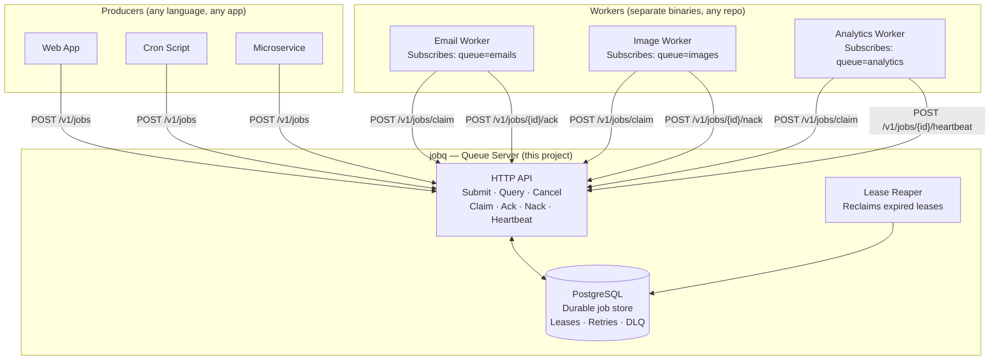
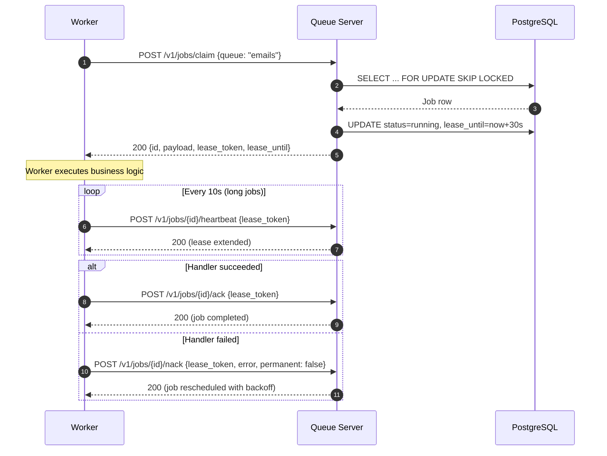
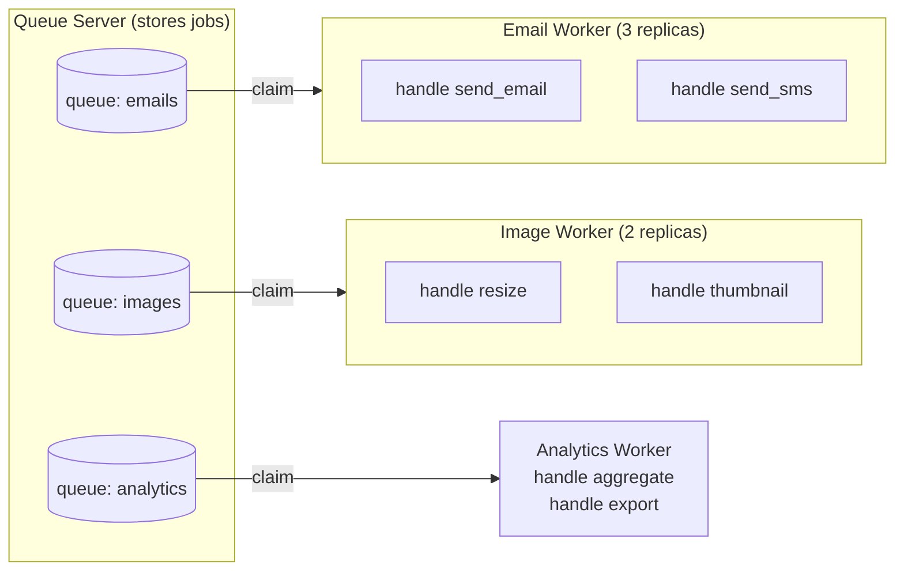
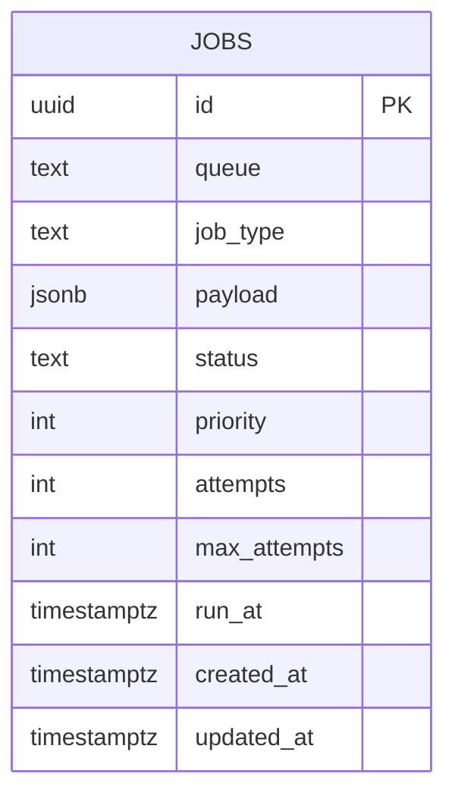
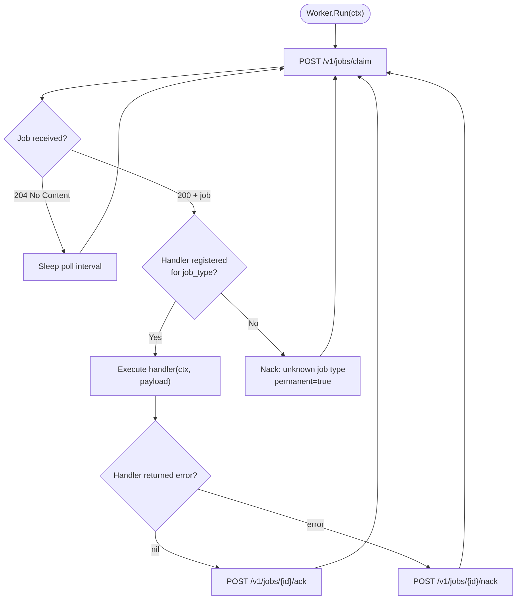
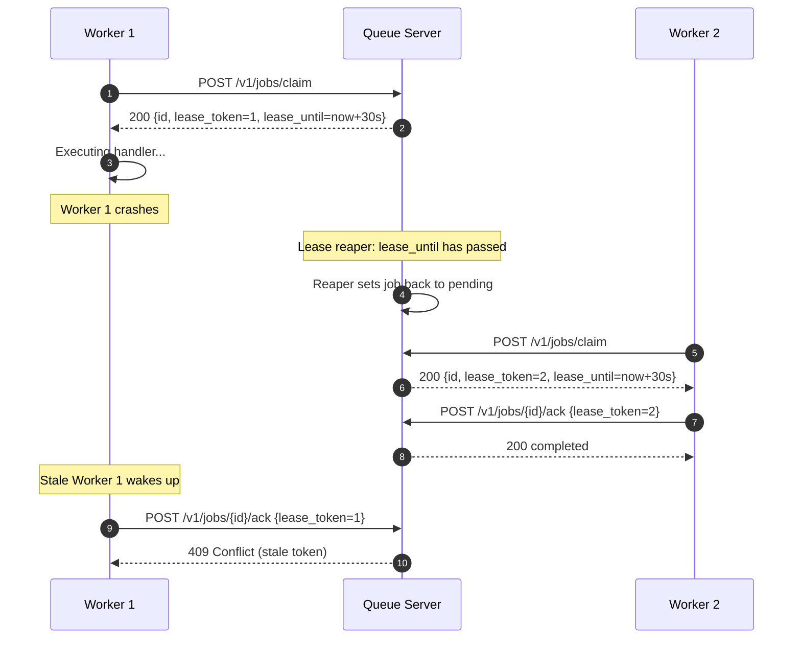
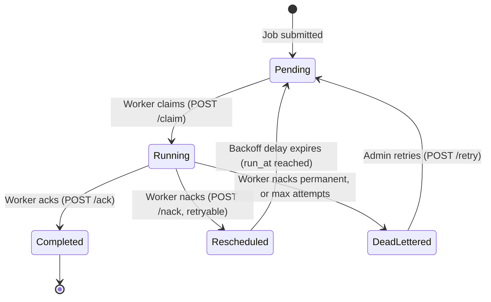
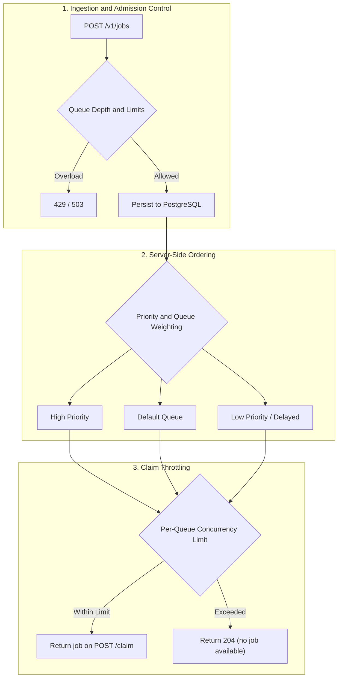
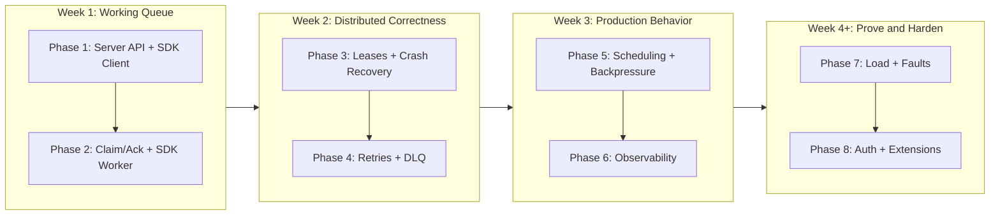
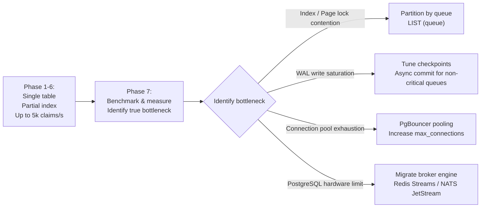

I'd build this as a production-inspired distributed job queue in Go, starting with a single-node implementation and gradually introducing distributed workers, failure recovery, and observability.

The goal isn't to build another CRUD application. It's to understand how infrastructure systems behave under concurrency, crashes, retries, and load.

# Distributed Job Queue in Go — Implementation Roadmap

# Project goal

Build a standalone job queue server — a reusable piece of infrastructure, like RabbitMQ or SQS. The server accepts jobs via HTTP, stores them durably in PostgreSQL, manages leases and retries, and exposes a claim/ack protocol that any worker can speak. Workers are separate, independent applications that subscribe to queues and execute business logic. The queue knows nothing about what jobs do. Workers know nothing about how jobs are stored.

## Architecture — two decoupled systems



### Key boundary

| Concern | Queue Server (jobq) | Worker (your app) |
|---------|-------------------|--------------------|
| Stores jobs | ✓ | ✗ |
| Manages leases, retries, DLQ | ✓ | ✗ |
| Knows what jobs *do* | ✗ | ✓ |
| Contains business logic | ✗ | ✓ |
| Speaks to PostgreSQL | ✓ | ✗ |
| Deployed independently | ✓ | ✓ |
| Written once, reused across projects | ✓ | ✗ (app-specific) |

Workers interact with the queue server only through its HTTP API. They never touch the database directly.

## The claim/ack protocol

This is the contract between queue server and workers. Every worker — regardless of language, repo, or team — uses these endpoints:



### Full API surface

**Producer endpoints** — used by apps submitting work:

| Method | Endpoint                  | Purpose                    |
| ------ | ------------------------- | -------------------------- |
| `POST` | `/v1/jobs`                | Submit a job               |
| `GET`  | `/v1/jobs/{id}`           | Get job status             |
| `DELETE`| `/v1/jobs/{id}`          | Cancel a pending job       |
| `GET`  | `/v1/queues/{name}/stats` | Queue statistics           |

**Worker endpoints** — used by consumers pulling work:

| Method | Endpoint                       | Purpose                              |
| ------ | ------------------------------ | ------------------------------------ |
| `POST` | `/v1/jobs/claim`               | Claim next available job from queue  |
| `POST` | `/v1/jobs/{id}/ack`            | Acknowledge success (job completed)  |
| `POST` | `/v1/jobs/{id}/nack`           | Report failure (retry or dead-letter)|
| `POST` | `/v1/jobs/{id}/heartbeat`      | Extend lease for long-running jobs   |

**Admin endpoints** — added in Phase 8:

| Method | Endpoint                          | Purpose                    |
| ------ | --------------------------------- | -------------------------- |
| `POST` | `/v1/jobs/{id}/retry`             | Retry a dead-lettered job  |
| `GET`  | `/v1/queues/{name}/dead-letters`  | List dead-lettered jobs    |
| `POST` | `/v1/admin/keys`                  | Create API key             |
| `DELETE`| `/v1/admin/keys/{id}`            | Revoke API key             |

### Claim request/response

```json
// POST /v1/jobs/claim
// Request:
{
  "queues": ["emails", "notifications"],
  "lease_duration_seconds": 30
}

// Response (200):
{
  "id": "550e8400-e29b-41d4-a716-446655440000",
  "queue": "emails",
  "job_type": "send_email",
  "payload": {"to": "user@example.com", "template": "welcome"},
  "attempts": 0,
  "max_attempts": 5,
  "lease_token": 1,
  "lease_until": "2026-10-30T15:30:00Z"
}

// Response (204 No Content) — no jobs available
```

### Ack / Nack

```json
// POST /v1/jobs/{id}/ack
{"lease_token": 1}
// → 200 if token matches, 409 if stale (job was reclaimed)

// POST /v1/jobs/{id}/nack
{
  "lease_token": 1,
  "error": "SMTP connection refused",
  "permanent": false
}
// → 200: server computes backoff, reschedules
// If permanent=true or max_attempts reached → dead-lettered
```

## What "register handlers" means

In the decoupled model, handler registration is **entirely a worker-side concept**. The queue server never sees it.

A worker is a program that:
1. Polls the queue server for jobs (via `POST /v1/jobs/claim`)
2. Looks at the `job_type` field in the response
3. Dispatches to the right function based on that type
4. Reports success/failure back (via `ack`/`nack`)

Here's what that looks like in code:

```go
// This is the WORKER binary, in a completely separate repo.
// It imports only the jobq Go client SDK.

package main

import (
    "context"
    "encoding/json"
    "log"
    "os"

    jobq "github.com/yourname/jobq-go"  // thin HTTP client SDK
)

func main() {
    client := jobq.NewClient(os.Getenv("JOBQ_URL")) // e.g., "http://jobq-server:8080"

    // --- Handler registration (worker-side only) ---
    // This map is local to the worker. The queue server doesn't know
    // these functions exist. It just stores payloads and delivers them.
    worker := jobq.NewWorker(client, jobq.WorkerConfig{
        Queues:      []string{"emails", "notifications"},
        Concurrency: 8,
        LeaseDuration: 30 * time.Second,
    })

    worker.Handle("send_email", handleSendEmail)
    worker.Handle("send_sms", handleSendSMS)
    worker.Handle("push_notification", handlePushNotification)

    // Blocks, polls queue server, dispatches to handlers
    if err := worker.Run(context.Background()); err != nil {
        log.Fatal(err)
    }
}

// --- Business logic lives here, not in the queue server ---

func handleSendEmail(ctx context.Context, payload json.RawMessage) error {
    var p struct {
        To       string `json:"to"`
        Template string `json:"template"`
    }
    if err := json.Unmarshal(payload, &p); err != nil {
        return jobq.PermanentError(err) // won't retry
    }
    return smtpClient.Send(p.To, p.Template)
}

func handleSendSMS(ctx context.Context, payload json.RawMessage) error {
    // ... Twilio API call
}

func handlePushNotification(ctx context.Context, payload json.RawMessage) error {
    // ... FCM/APNs call
}
```

The key insight: **`worker.Handle("send_email", fn)` just populates a local `map[string]Handler`**. When the worker claims a job with `job_type: "send_email"`, it looks up `"send_email"` in that map and calls the function. If there's no match, it nacks with a permanent error.

The queue server doesn't validate job types. It stores `"send_email"` as an opaque string. Different workers can handle different types. Multiple workers can handle the same type (horizontal scaling). A worker can subscribe to multiple queues.



---

## Project layout — three deliverables

```
jobq/                              ← This repo
├── cmd/
│   └── jobq-server/
│       └── main.go                ← Queue server binary
├── internal/
│   ├── httpapi/                   ← HTTP handlers (submit, claim, ack, nack, heartbeat)
│   ├── storage/                   ← PostgreSQL queries (pgx)
│   ├── leaser/                    ← Lease reaper goroutine
│   ├── scheduler/                 ← Backoff, retry, priority logic
│   ├── auth/                      ← API key middleware (Phase 8)
│   └── observability/             ← Prometheus, structured logging
├── migrations/
│   ├── 001_create_jobs.up.sql
│   ├── 001_create_jobs.down.sql
│   ├── 002_add_leases.up.sql
│   └── ...
├── sdk/
│   └── go/                        ← jobq-go: Go client SDK
│       ├── client.go              ← HTTP client (Submit, Claim, Ack, Nack, Heartbeat)
│       ├── worker.go              ← Worker loop + handler dispatch
│       ├── errors.go              ← PermanentError type
│       └── go.mod                 ← separate Go module: github.com/yourname/jobq-go
├── examples/
│   └── email-worker/
│       ├── main.go                ← Example worker using the SDK
│       └── go.mod                 ← imports jobq-go SDK only, not internal/
├── tests/
│   ├── integration/               ← Server-side tests (Phases 1-6)
│   ├── sdk/                       ← SDK + worker tests (Phase 2+)
│   ├── failure/                   ← Crash/kill tests (Phase 3)
│   └── load/                      ← Benchmarks (Phase 7)
├── docker-compose.yml
├── go.mod                         ← server module
└── README.md
```

### What each piece does

**`cmd/jobq-server`** — The queue server. One binary. Connects to PostgreSQL. Exposes the HTTP API. Runs the lease reaper. This is the infrastructure you deploy once and reuse.

**`sdk/go` (jobq-go)** — Thin Go client library. Wraps HTTP calls. Provides `Worker` struct with handler registration and polling loop. Published as a separate Go module so workers import only this, not the server's internals.

**`examples/email-worker`** — A sample worker showing how to use the SDK. Separate `go.mod`, imports only `jobq-go`. Demonstrates that workers are truly independent.

Initial tech stack

- Go, `net/http` or Chi for the API
- PostgreSQL for persistence and job coordination
- `pgx` for database access
- SQL migrations
- Docker Compose for local deployment
- Prometheus metrics and OpenTelemetry tracing in later phases
- Go's standard library for concurrency, contexts, channels, and synchronization

Start with PostgreSQL rather than building your own broker. The goal is to learn distributed job processing, not spend the project implementing a storage engine.

---

## Phase 1 — Job model, API, and SDK client

Difficulty: Easy

Estimated time: 2–3 days

Objective: Build the queue server's submit/query API and a basic Go SDK client. No workers yet.

### Implement (server side)

1. Define the job lifecycle and database schema.
2. Implement job submission (`POST /v1/jobs`).
3. Implement job retrieval (`GET /v1/jobs/{id}`).
4. Implement queue stats (`GET /v1/queues/{name}/stats`).
5. Add input validation and error handling.
6. Add migrations.

### Implement (SDK side)

1. `client.go` — `NewClient(baseURL)`, `Submit(ctx, job)`, `GetJob(ctx, id)`, `GetQueueStats(ctx, queue)`.
2. HTTP calls only. No business logic.

Suggested schema:

```sql
CREATE TABLE jobs (
    id            UUID PRIMARY KEY DEFAULT gen_random_uuid(),
    queue         TEXT NOT NULL DEFAULT 'default',
    job_type      TEXT NOT NULL,
    payload       JSONB NOT NULL,
    status        TEXT NOT NULL DEFAULT 'pending'
                  CHECK (status IN ('pending','running','completed','failed','dead_lettered','cancelled')),
    priority      INT NOT NULL DEFAULT 0,
    attempts      INT NOT NULL DEFAULT 0,
    max_attempts  INT NOT NULL DEFAULT 5,
    run_at        TIMESTAMPTZ NOT NULL DEFAULT now(),
    created_at    TIMESTAMPTZ NOT NULL DEFAULT now(),
    updated_at    TIMESTAMPTZ NOT NULL DEFAULT now()
);

CREATE INDEX idx_jobs_claimable ON jobs (priority DESC, created_at ASC)
    WHERE status = 'pending' AND run_at <= now();
```



A submitted job looks like:

```json
{
  "queue": "emails",
  "job_type": "send_email",
  "payload": {
    "to": "user@example.com",
    "template": "welcome"
  },
  "max_attempts": 5
}
```

The queue server stores this verbatim. It does not validate `job_type` against any registry — that's the worker's concern.

### Phase 1 — Verification tests

Run with `go test ./tests/integration/ -tags=integration -run TestPhase1`.

| # | Test name | What it proves | Pass criteria |
|---|-----------|----------------|---------------|
| 1 | `TestSubmitJob_Success` | Happy path submit | POST `/v1/jobs` → 201, response has `id` + `status:"pending"` |
| 2 | `TestSubmitJob_InvalidPayload` | Validation rejects garbage | POST with empty `job_type` → 400, body has error message |
| 3 | `TestSubmitJob_MissingPayload` | Payload required | POST with `payload: null` → 400 |
| 4 | `TestGetJob_Exists` | Retrieval works | Submit → GET `/v1/jobs/{id}` → 200, fields match |
| 5 | `TestGetJob_NotFound` | Missing ID handled | GET random UUID → 404 |
| 6 | `TestGetJob_InvalidID` | Bad ID handled | GET `/v1/jobs/not-a-uuid` → 400 |
| 7 | `TestQueueStats` | Stats endpoint counts | Submit 5 jobs to queue "emails" → GET `/v1/queues/emails/stats` → `pending: 5` |
| 8 | `TestJobSurvivesRestart` | Durability | Submit job → restart API process → GET same `id` → 200, same fields |
| 9 | `TestSubmitJob_DuplicateID` | Idempotent submit | POST same client-supplied ID twice → second returns 409 or 200 (not duplicate row) |
| 10 | `TestSDKClient_Submit` | SDK works | Use `jobq.NewClient(url).Submit(ctx, job)` → returns `Job` struct with `ID` populated |
| 11 | `TestSDKClient_GetJob` | SDK retrieval | Submit via SDK → `client.GetJob(ctx, id)` → fields match |

```go
// tests/sdk/phase1_test.go — skeleton
func TestSDKClient_Submit(t *testing.T) {
    client := jobq.NewClient(serverURL)
    job, err := client.Submit(context.Background(), jobq.SubmitRequest{
        Queue:   "test",
        JobType: "noop",
        Payload: json.RawMessage(`{}`),
    })
    require.NoError(t, err)
    require.NotEmpty(t, job.ID)
    require.Equal(t, "pending", job.Status)
}
```

**Benchmark — Phase 1**

```go
func BenchmarkSubmitJob(b *testing.B) {
    b.ReportAllocs()
    client := jobq.NewClient(serverURL)
    for i := 0; i < b.N; i++ {
        client.Submit(context.Background(), jobq.SubmitRequest{
            Queue: "bench", JobType: "noop", Payload: json.RawMessage(`{}`),
        })
    }
}
// Target: > 1000 inserts/sec on local Postgres.
```

Phase complete when: All 11 tests pass. Benchmark prints inserts/sec. SDK client can submit and retrieve jobs through the HTTP API.

---

## Phase 2 — Claim/ack protocol and SDK worker

Difficulty: Medium

Estimated time: 3–4 days

Objective: Workers can claim jobs via HTTP, execute them, and report results. No leases yet — simple claim-and-execute.

### Implement (server side)

- `POST /v1/jobs/claim` — atomically claim a pending job, return it.
- `POST /v1/jobs/{id}/ack` — mark job completed.
- `POST /v1/jobs/{id}/nack` — mark job failed.
- Use PostgreSQL transactions when claiming to prevent double-claim.

### Implement (SDK side)

- `client.Claim(ctx, queues)` — HTTP call to claim endpoint.
- `client.Ack(ctx, id, token)` — acknowledge completion.
- `client.Nack(ctx, id, token, error, permanent)` — report failure.
- `Worker` struct — polling loop + handler registration + dispatch.
- `worker.Handle(jobType, handler)` — register a handler function.
- `worker.Run(ctx)` — poll, dispatch, ack/nack loop.
- Configurable concurrency (worker pool of goroutines).
- Graceful shutdown via `context.Context`.

```go
// SDK types
type Handler func(ctx context.Context, payload json.RawMessage) error

type Worker struct {
    client   *Client
    handlers map[string]Handler  // "send_email" → func
    config   WorkerConfig
}

type WorkerConfig struct {
    Queues        []string
    Concurrency   int
    PollInterval  time.Duration
}
```

Conceptual execution loop:



Important: Never hold a database transaction open for job execution. The server claims the job in a short transaction, returns it to the worker, and the worker makes a separate HTTP call to ack/nack when done.

### Phase 2 — Verification tests

Run with `go test ./tests/integration/ -tags=integration -run TestPhase2` and `go test ./tests/sdk/ -tags=integration -run TestPhase2`.

**Server-side tests:**

| # | Test name | What it proves | Pass criteria |
|---|-----------|----------------|---------------|
| 1 | `TestClaim_ReturnsJob` | Claim works | Submit job → `POST /v1/jobs/claim {queues:["test"]}` → 200, response has `id`, `payload` |
| 2 | `TestClaim_EmptyQueue` | No jobs returns 204 | Claim from empty queue → 204 No Content |
| 3 | `TestClaim_MarksRunning` | Status changes | Claim job → GET `/v1/jobs/{id}` → `status: "running"` |
| 4 | `TestClaim_NoDuplicates` | Atomic claiming | Submit 1 job → 10 concurrent claim requests → exactly 1 gets 200, other 9 get 204 |
| 5 | `TestAck_CompletesJob` | Ack works | Claim → ack → GET → `status: "completed"` |
| 6 | `TestNack_FailsJob` | Nack works | Claim → nack → GET → `status: "failed"`, `last_error` populated |
| 7 | `TestAck_WrongToken` | Stale token rejected | Claim (token=T) → manually ack with token=T+1 → 409 Conflict |

**SDK worker tests:**

| # | Test name | What it proves | Pass criteria |
|---|-----------|----------------|---------------|
| 8 | `TestWorker_ExecutesHandler` | End-to-end via SDK | Submit job → worker.Handle("test", fn) → fn called → job completed |
| 9 | `TestWorker_UnknownType` | Unknown type → permanent nack | Submit `job_type:"unknown"` → worker nacks → job goes to failed |
| 10 | `TestWorker_ConcurrencyLimit` | Pool size respected | Set Concurrency=3, submit 10 jobs, track max concurrent via atomic → never exceeds 3 |
| 11 | `TestWorker_GracefulShutdown` | Clean stop | Cancel ctx → worker finishes in-flight job, stops claiming, Run() returns |
| 12 | `TestWorker_MultipleQueues` | Subscribes to N queues | Worker subscribes to ["emails","sms"] → processes jobs from both |

```go
// tests/sdk/phase2_test.go — skeleton
func TestWorker_ExecutesHandler(t *testing.T) {
    client := jobq.NewClient(serverURL)
    var executed atomic.Bool

    worker := jobq.NewWorker(client, jobq.WorkerConfig{
        Queues:      []string{"test"},
        Concurrency: 1,
        PollInterval: 100 * time.Millisecond,
    })
    worker.Handle("greet", func(ctx context.Context, p json.RawMessage) error {
        executed.Store(true)
        return nil
    })

    ctx, cancel := context.WithCancel(context.Background())
    go worker.Run(ctx)
    defer cancel()

    client.Submit(ctx, jobq.SubmitRequest{
        Queue: "test", JobType: "greet", Payload: json.RawMessage(`{}`),
    })

    require.Eventually(t, func() bool { return executed.Load() }, 5*time.Second, 100*time.Millisecond)
}
```

**Benchmark — Phase 2**

```go
func BenchmarkWorkerThroughput(b *testing.B) {
    // Submit b.N jobs via SDK
    // Start worker with 8 goroutines, no-op handler
    // Measure wall time until all completed
    // Report: jobs/sec, allocs/op
    // Target: > 500 jobs/sec with 8-goroutine worker on local Postgres
}
```

Phase complete when: All 12 tests pass. A standalone worker binary (using only the SDK) processes jobs submitted by a separate producer.

---

## Phase 3 — Leases, heartbeats, and crash recovery

Difficulty: Hard

Estimated time: 4–6 days

Objective: Run multiple independent worker processes. Recover work when a worker dies.

### Implement (server side)

- Add lease columns to schema.
- Claim assigns `lease_owner`, `lease_until`, `lease_token`.
- `POST /v1/jobs/{id}/heartbeat` extends lease.
- Lease reaper goroutine: periodically scans for expired leases, transitions jobs back to pending.
- Fencing tokens: all ack/nack/heartbeat calls require matching `lease_token`.

```sql
ALTER TABLE jobs ADD COLUMN lease_owner   TEXT;
ALTER TABLE jobs ADD COLUMN lease_until   TIMESTAMPTZ;
ALTER TABLE jobs ADD COLUMN lease_token   INT NOT NULL DEFAULT 0;
ALTER TABLE jobs ADD COLUMN last_error    TEXT;
```

Claim query:

```sql
WITH claimed AS (
    SELECT id FROM jobs
    WHERE status = 'pending'
      AND run_at <= now()
      AND queue = ANY($1)
    ORDER BY priority DESC, created_at ASC
    FOR UPDATE SKIP LOCKED
    LIMIT 1
)
UPDATE jobs SET
    status = 'running',
    lease_owner = $2,
    lease_until = now() + $3::interval,
    lease_token = lease_token + 1,
    updated_at = now()
FROM claimed WHERE jobs.id = claimed.id
RETURNING jobs.*;
```

Lease reaper (runs every N seconds in the server):

```sql
UPDATE jobs SET
    status = 'pending',
    lease_owner = NULL,
    lease_until = NULL,
    updated_at = now()
WHERE status = 'running'
  AND lease_until < now();
```

### Implement (SDK side)

- `client.Heartbeat(ctx, id, token)` — extend lease.
- Worker auto-heartbeats in background goroutine for long-running handlers.
- Configurable `LeaseDuration` and `HeartbeatInterval`.



### Phase 3 — Verification tests

Run with `go test ./tests/integration/ -tags=integration -run TestPhase3` and `go test ./tests/failure/ -tags=failure -run TestPhase3`.

**Server-side tests:**

| # | Test name | What it proves | Pass criteria |
|---|-----------|----------------|---------------|
| 1 | `TestClaim_SetsLease` | Lease columns populated | Claim job → GET → `lease_owner` set, `lease_until` in future, `lease_token > 0` |
| 2 | `TestHeartbeat_ExtendsLease` | Heartbeat works | Claim → heartbeat → GET → `lease_until` advanced beyond original |
| 3 | `TestHeartbeat_WrongToken` | Stale heartbeat rejected | Claim (token=1) → heartbeat with token=99 → 409 |
| 4 | `TestReaper_RecoverExpiredLease` | Reaper works | Claim with 1s lease, don't ack → wait 2s → GET → `status: "pending"` again |
| 5 | `TestFencingToken_RejectsStaleAck` | Fencing works | Claim (token=1) → force reclaim (token=2) → ack with token=1 → 409 |

**Multi-process failure tests:**

| # | Test name | What it proves | Pass criteria |
|---|-----------|----------------|---------------|
| 6 | `TestCrash_AfterClaim` | Crash right after claim | Start worker process → SIGKILL after claim → lease expires → another worker completes job |
| 7 | `TestCrash_DuringExecution` | Crash mid-handler | Handler sleeps 5s, SIGKILL at 1s → lease expires → job reclaimed and completed |
| 8 | `TestCrash_AfterSideEffect` | At-least-once delivery | Handler writes marker file, sleep before ack → SIGKILL → job re-executes → marker written twice |
| 9 | `TestMultiProcess_NoDuplicates` | No double processing | 2 worker processes, 100 jobs → each completed exactly once (query DB) |
| 10 | `TestMultiProcess_FairDistribution` | Work spreads | 3 worker processes, 300 jobs → each gets 80-120 jobs |
| 11 | `TestLeaseRenewal_LongJob` | Long jobs survive | 10s handler, 3s lease, SDK auto-heartbeats → job completes (not reclaimed) |

```go
// tests/failure/phase3_test.go — crash test skeleton
func TestCrash_AfterClaim(t *testing.T) {
    client := jobq.NewClient(serverURL)
    job, _ := client.Submit(ctx, jobq.SubmitRequest{
        Queue: "test", JobType: "slow", Payload: json.RawMessage(`{}`),
    })

    // Start worker process that handles "slow" with a 30s sleep
    cmd := exec.Command(exampleWorkerBinary, "--queues=test", "--lease-duration=2s")
    cmd.Start()

    waitForStatus(t, client, job.ID, "running", 5*time.Second)

    // Kill hard
    cmd.Process.Signal(syscall.SIGKILL)
    cmd.Wait()

    // Start second worker
    cmd2 := exec.Command(exampleWorkerBinary, "--queues=test", "--lease-duration=2s")
    cmd2.Start()
    defer cmd2.Process.Kill()

    waitForStatus(t, client, job.ID, "completed", 10*time.Second)
}
```

**Benchmark — Phase 3**

```go
func BenchmarkMultiProcessClaim(b *testing.B) {
    // Pre-insert b.N pending jobs
    // Start 4 worker processes (separate binaries via exec.Command)
    // Measure: time until all completed
    // Report: claims/sec across processes
    // Target: > 300 claims/sec with 4 processes
}
```

Phase complete when: All 11 tests pass. Can `kill -9` a worker and watch recovery happen via the lease reaper.

---

## Phase 4 — Retries, delayed jobs, and dead-letter queues

Difficulty: Medium–Hard

Estimated time: 3–4 days

Objective: Make failure handling a first-class feature. All retry logic lives in the server — workers just nack with an error.

### Implement (server side)

- On nack: if `permanent=true` or `attempts >= max_attempts` → dead-letter. Otherwise, compute backoff delay, set `run_at`, reset to pending.
- Exponential backoff with jitter (server-side computation).
- `POST /v1/jobs/{id}/retry` — retry a dead-lettered job.
- `GET /v1/queues/{name}/dead-letters` — list dead-lettered jobs.

Workers don't compute delays or decide retry policy. They report success or failure. The server decides what happens next.



Nack handling on server:

```go
// Server-side logic when processing POST /v1/jobs/{id}/nack
func (s *Server) handleNack(job *Job, req NackRequest) {
    job.Attempts++
    job.LastError = req.Error

    if req.Permanent || job.Attempts >= job.MaxAttempts {
        job.Status = "dead_lettered"
    } else {
        // Server computes backoff — worker doesn't need to know
        delay := min(maxDelay, baseDelay * (1 << job.Attempts))
        jitter := rand.Float64() * float64(delay) * 0.3
        job.RunAt = time.Now().Add(delay + time.Duration(jitter))
        job.Status = "pending"
    }
    job.LeaseOwner = nil
    job.LeaseUntil = nil
}
```

### Phase 4 — Verification tests

Run with `go test ./tests/integration/ -tags=integration -run TestPhase4`.

| # | Test name | What it proves | Pass criteria |
|---|-----------|----------------|---------------|
| 1 | `TestRetry_ExponentialBackoff` | Backoff timing correct | Handler fails 3 times → check `run_at` deltas: d1 ≈ base, d2 ≈ 2×base, d3 ≈ 4×base (±30% for jitter) |
| 2 | `TestRetry_MaxAttempts` | Exhaustion → dead-letter | `max_attempts=3`, always nack → after 3, `status = 'dead_lettered'` |
| 3 | `TestRetry_SuccessOnThird` | Transient failures recover | Handler fails twice, succeeds third → `status = 'completed'`, `attempts = 3` |
| 4 | `TestPermanentNack_SkipsRetry` | Permanent → dead-letter immediately | Nack with `permanent=true` → `status = 'dead_lettered'`, `attempts = 1` |
| 5 | `TestDelayedJob` | `run_at` in future respected | Submit with `run_at = now+5s` → not claimed for ~5s → then completes |
| 6 | `TestDeadLetter_ManualRetry` | Retry endpoint works | Dead-lettered job → POST `/v1/jobs/{id}/retry` → `status = 'pending'`, `attempts` reset |
| 7 | `TestDeadLetter_ListEndpoint` | List dead letters | Dead-letter 3 jobs → GET `/v1/queues/test/dead-letters` → returns 3 |
| 8 | `TestJitter_SpreadRetries` | Jitter prevents thundering herd | Nack 20 jobs simultaneously → `run_at` values differ (stddev > 0.5s) |
| 9 | `TestBackoff_Cap` | Max delay capped | Set cap=60s, fail 10 times → `run_at` delta never exceeds 60s + max_jitter |

```go
// tests/integration/phase4_test.go — skeleton
func TestRetry_SuccessOnThird(t *testing.T) {
    client := jobq.NewClient(serverURL)
    var attempts atomic.Int32

    worker := jobq.NewWorker(client, jobq.WorkerConfig{
        Queues: []string{"test"}, Concurrency: 1,
    })
    worker.Handle("flaky", func(ctx context.Context, p json.RawMessage) error {
        n := attempts.Add(1)
        if n < 3 {
            return fmt.Errorf("transient failure %d", n)
        }
        return nil // succeed on 3rd
    })

    job, _ := client.Submit(ctx, jobq.SubmitRequest{
        Queue: "test", JobType: "flaky",
        Payload: json.RawMessage(`{}`), MaxAttempts: 5,
    })

    go worker.Run(ctx)
    waitForStatus(t, client, job.ID, "completed", 120*time.Second)

    final, _ := client.GetJob(ctx, job.ID)
    require.Equal(t, 3, final.Attempts)
}
```

**Benchmark — Phase 4**

```go
func BenchmarkRetryThroughput(b *testing.B) {
    // Submit b.N jobs that fail once then succeed
    // Measure: total time including backoff
    // Report: retried-jobs/sec
}
```

Phase complete when: All 9 tests pass. Workers just return errors; server handles all retry logic.

---

## Phase 5 — Ordering, scheduling, and backpressure

Difficulty: Medium–Hard

Estimated time: 4–5 days

Objective: Make the queue controllable under real workloads.

### Implement (server side)

- Priority-based claim ordering (already in claim query).
- Multiple logical queues (workers claim from specific queues).
- Per-queue concurrency limits (server tracks active leases per queue).
- Rate limiting on claim endpoint per queue.
- Maximum payload sizes.
- Admission control: reject submits when queue depth exceeds limit.

Workers don't need to change. They just claim from their configured queues. All scheduling decisions live in the server.



### Phase 5 — Verification tests

Run with `go test ./tests/integration/ -tags=integration -run TestPhase5`.

| # | Test name | What it proves | Pass criteria |
|---|-----------|----------------|---------------|
| 1 | `TestPriority_HighBeforeLow` | Priority ordering | Submit low-pri then high-pri → claim returns high-pri first |
| 2 | `TestPriority_Starvation` | Low-pri eventually runs | Continuous high-pri + 1 low-pri → low-pri completes within 30s |
| 3 | `TestMultiQueue_Isolation` | Queues independent | Submit to "emails" and "reports" → claim from "emails" only gets email jobs |
| 4 | `TestPerQueueConcurrency` | Concurrency limit per queue | Limit "api-calls" to 2 active leases → 3rd claim returns 204 while 2 are running |
| 5 | `TestBackpressure_Reject` | Overload returns 429 | Set depth limit=100 → submit 150 → last 50 get 429 |
| 6 | `TestPayloadSizeLimit` | Oversized payload rejected | Set limit=1MB → submit 2MB → 413 |
| 7 | `TestRateLimit_ClaimThrottle` | Claim rate limited | Set 10 claims/sec per queue → rapid claims → some get 429 |
| 8 | `TestScheduledJob_Future` | Future run_at respected | Submit `run_at=now+10s` → claim returns 204 for 10s → then returns job |
| 9 | `TestAdmissionControl_QueueDepth` | Stats reflect depth | Submit 50 → GET `/v1/queues/test/stats` → `pending >= 50` |

**Benchmark — Phase 5**

```go
func BenchmarkBackpressure(b *testing.B) {
    // Set queue depth limit = 1000
    // b.N goroutines submit jobs concurrently
    // Measure: accepted vs rejected ratio, latency of rejects
    // Target: reject latency < 1ms (no DB hit on reject path)
}

func BenchmarkPriorityOrdering(b *testing.B) {
    // Insert b.N jobs with random priorities 0-9
    // Start 4 workers, measure completion order correlation with priority
}
```

Phase complete when: All 9 tests pass. Workers unchanged from Phase 2 — all new logic is server-side.

---

## Phase 6 — Observability and operational readiness

Difficulty: Medium

Estimated time: 3–4 days

Objective: Diagnose the system without reading database rows manually.

### Metrics (server side)

Expose Prometheus metrics:

- `jobq_jobs_submitted_total` (counter, labels: queue, job_type)
- `jobq_jobs_completed_total` (counter, labels: queue, job_type)
- `jobq_jobs_failed_total` (counter, labels: queue, job_type)
- `jobq_jobs_dead_lettered_total` (counter, labels: queue, job_type)
- `jobq_queue_depth` (gauge, labels: queue, status)
- `jobq_job_duration_seconds` (histogram, labels: queue, job_type)
- `jobq_queue_wait_seconds` (histogram, labels: queue)
- `jobq_claims_total` (counter, labels: queue, result=claimed|empty)
- `jobq_lease_reclaims_total` (counter, labels: queue)
- `jobq_active_leases` (gauge, labels: queue)

### Logging and tracing

Structured logs with job ID, queue, job_type, worker (lease_owner), attempt number. Propagate trace context where appropriate.

### Operations

- `GET /healthz` — liveness probe (server running).
- `GET /readyz` — readiness probe (DB reachable).
- Graceful shutdown: stop accepting requests, wait for in-flight responses, stop lease reaper.
- Configuration via environment variables.
- Database connection pool limits.

### Phase 6 — Verification tests

Run with `go test ./tests/integration/ -tags=integration -run TestPhase6`.

| # | Test name | What it proves | Pass criteria |
|---|-----------|----------------|---------------|
| 1 | `TestMetrics_JobCounters` | Counters increment | Submit + complete 1 job → scrape `/metrics` → `jobq_jobs_submitted_total` ≥ 1 |
| 2 | `TestMetrics_QueueDepth` | Gauge tracks depth | Submit 10 jobs → `jobq_queue_depth{queue="test",status="pending"}` = 10 |
| 3 | `TestMetrics_ExecutionHistogram` | Duration recorded | Complete a 100ms job → `jobq_job_duration_seconds_bucket{le="0.25"}` ≥ 1 |
| 4 | `TestMetrics_WaitTime` | Queue latency visible | Submit job, claim 2s later → `jobq_queue_wait_seconds` bucket ≥2s has count ≥ 1 |
| 5 | `TestMetrics_LeaseReclaims` | Reclaim counted | Force lease expiry → `jobq_lease_reclaims_total` ≥ 1 |
| 6 | `TestHealthEndpoint` | Liveness probe | GET `/healthz` → 200 `{"status":"ok"}` |
| 7 | `TestReadyEndpoint` | Readiness probe | GET `/readyz` → 200 when DB reachable, 503 when not |
| 8 | `TestGracefulShutdown_Server` | Clean exit | SIGTERM → in-flight HTTP responses complete, server exits 0 |
| 9 | `TestStructuredLogs` | Log fields present | Submit + complete 1 job → log output has `job_id`, `queue`, `attempt` |
| 10 | `TestMetrics_Concurrent` | Thread safety | 10 goroutines submit+claim+ack → no panic, counters consistent |

**Benchmark — Phase 6**

```go
func BenchmarkMetricsOverhead(b *testing.B) {
    // Submit + claim + ack b.N jobs with metrics enabled vs disabled
    // Report: overhead per job in ns
    // Target: < 5% throughput reduction
}
```

Phase complete when: All 10 tests pass. Can diagnose delayed/failing jobs using Prometheus metrics without touching the DB.

---

## Phase 7 — Benchmark and fault-injection testing

Difficulty: Hard

Estimated time: 4–5 days

Objective: Prove the system's behavior under load and failure.

Build a load generator that submits jobs with configurable payload sizes, arrival rates, and handler durations.

Measure:

| Metric                       | What it tells you                           |
| ---------------------------- | ------------------------------------------- |
| Enqueue throughput           | How quickly the API accepts durable jobs    |
| Completion throughput        | How quickly workers finish jobs             |
| Queue wait time, p50/p95/p99 | How long jobs wait before execution         |
| Execution latency            | How long handlers take                      |
| Recovery time                | How quickly abandoned jobs become available |
| Duplicate execution rate     | How often work runs more than once          |
| Database utilization         | Whether PostgreSQL is the bottleneck        |

### Phase 7 — Verification tests

Run with `go test ./tests/load/ -tags=load -run TestPhase7 -timeout=300s`.

| # | Test name | What it proves | Pass criteria |
|---|-----------|----------------|---------------|
| 1 | `TestLoadGen_SustainedThroughput` | Steady state | 1000 jobs/sec for 60s, 8-goroutine worker → all complete, p99 wait < 5s |
| 2 | `TestLoadGen_Burst` | Burst absorbed | 5000 jobs in 1s → all complete within 30s |
| 3 | `TestFaultInject_WorkerKill` | Kill recovery | 500 jobs, kill 1 of 4 workers at 250 → all 500 complete |
| 4 | `TestFaultInject_PostgresRestart` | DB restart | Kill postgres, wait 5s, restart → workers reconnect, jobs resume |
| 5 | `TestFaultInject_SlowHandler` | Timeout/reclaim | Handler sleeps 60s, 5s lease → lease expires, job reclaimed |
| 6 | `TestFaultInject_ServerRestart` | Queue server restart | Restart jobq-server mid-load → workers reconnect, no jobs lost |
| 7 | `TestDuplicateExecution_Rate` | At-most-once goal | 1000 jobs with idempotency tracking → duplicate rate < 1% |
| 8 | `TestScaling_1v4v8Workers` | Throughput scales | 1, 4, 8 worker goroutines → throughput ratio ≈ 1:3.5:6.5 |
| 9 | `TestRecoveryTime` | Recovery SLA | Kill worker with 10 active leases (5s) → p95 reclaim < lease_duration + 3s |

**Reporting template:**

```
## Load Test Results — $(date)
| Metric | 1 worker | 4 workers | 8 workers |
|--------|----------|-----------|-----------|
| Enqueue throughput (jobs/sec) | | | |
| Completion throughput (jobs/sec) | | | |
| Wait time p50 / p95 / p99 | | | |
| Recovery time p95 | | | |
| Duplicate execution rate | | | |
| Peak DB connections | | | |
```

Phase complete when: All 9 tests pass. Load report generated with real numbers.

---

## Phase 8 — Authentication, authorization, and advanced extensions

Difficulty: Medium–Hard

Estimated time: 4–5 days

Objective: Secure the API and add optional advanced features.

### 8.1 Authentication and authorization

- API key authentication via `Authorization: Bearer <key>` header.
- Key storage in PostgreSQL (hashed, not plaintext).
- Per-key permissions: `submit`, `claim`, `admin`.
- Rate limiting per API key.
- Admin endpoints gated by `admin` permission.
- SDK accepts API key in `NewClient(url, WithAPIKey(key))`.

```sql
CREATE TABLE api_keys (
    id          UUID PRIMARY KEY DEFAULT gen_random_uuid(),
    key_hash    TEXT NOT NULL UNIQUE,
    name        TEXT NOT NULL,
    permissions TEXT[] NOT NULL DEFAULT '{"submit","claim"}',
    rate_limit  INT NOT NULL DEFAULT 100,  -- requests/min
    created_at  TIMESTAMPTZ NOT NULL DEFAULT now(),
    revoked_at  TIMESTAMPTZ
);
```

| Method   | Endpoint               | Permission | Purpose              |
| -------- | ---------------------- | ---------- | -------------------- |
| `POST`   | `/v1/admin/keys`       | `admin`    | Create API key       |
| `DELETE` | `/v1/admin/keys/{id}`  | `admin`    | Revoke API key       |
| `GET`    | `/v1/admin/keys`       | `admin`    | List API keys        |

#### Auth verification tests

| # | Test name | What it proves | Pass criteria |
|---|-----------|----------------|---------------|
| 1 | `TestAuth_NoKey_Rejected` | Unauthenticated blocked | POST `/v1/jobs` without header → 401 |
| 2 | `TestAuth_InvalidKey_Rejected` | Bad key blocked | POST with `Bearer garbage` → 401 |
| 3 | `TestAuth_RevokedKey_Rejected` | Revoked key blocked | Create key, revoke, use → 401 |
| 4 | `TestAuth_SubmitPermission` | Permission enforced | Key with `submit` only → POST `/v1/jobs` works, POST `/v1/admin/keys` → 403 |
| 5 | `TestAuth_ClaimPermission` | Claim gated | Key with `submit` only → POST `/v1/jobs/claim` → 403 |
| 6 | `TestAuth_RateLimit` | Per-key throttling | limit=5/min → 6th request → 429 |

### 8.2 Optional advanced extensions

- Event-driven wakeups: PostgreSQL LISTEN/NOTIFY to reduce polling latency.
- Broker comparison: Swap PostgreSQL for Redis Streams or NATS JetStream. Benchmark the difference.
- Multi-tenancy: Tenant isolation, quotas, fairness.
- Horizontal API scaling: Multiple stateless jobq-server instances behind a load balancer.
- gRPC API: Alternative to HTTP for higher-throughput worker communication.
- SDK in other languages: Python, TypeScript clients for polyglot workers.

Phase complete when: All 6 auth tests pass. SDK passes API key transparently.

---

## Test run commands — quick reference

```bash
# Phase 1 — API + SDK client
go test ./tests/integration/ -tags=integration -run TestPhase1 -v
go test ./tests/sdk/          -tags=integration -run TestPhase1 -v

# Phase 2 — Claim/ack + SDK worker
go test ./tests/integration/ -tags=integration -run TestPhase2 -v
go test ./tests/sdk/          -tags=integration -run TestPhase2 -v

# Phase 3 — Leases + crash recovery
go test ./tests/integration/ -tags=integration -run TestPhase3 -v
go test ./tests/failure/     -tags=failure     -run TestPhase3 -v -timeout=120s

# Phase 4 — Retries and dead-letter
go test ./tests/integration/ -tags=integration -run TestPhase4 -v

# Phase 5 — Ordering and backpressure
go test ./tests/integration/ -tags=integration -run TestPhase5 -v

# Phase 6 — Observability
go test ./tests/integration/ -tags=integration -run TestPhase6 -v

# Phase 7 — Load and fault injection
go test ./tests/load/ -tags=load -run TestPhase7 -v -timeout=300s

# Phase 8 — Auth
go test ./tests/integration/ -tags=integration -run TestAuth -v

# All benchmarks
go test ./tests/... -tags=integration -bench=. -benchmem -run=^$ -timeout=300s

# Full regression (all phases)
go test ./tests/... -tags=integration,failure,load -v -timeout=600s
```

## Timeline and priorities



### Week 1 — Working queue

Phases 1–2: server API, SDK client, claim/ack protocol, SDK worker with handler registration.

### Week 2 — Distributed correctness

Phases 3–4: leases, heartbeats, crash recovery, fencing tokens, retries, dead-lettering.

### Week 3 — Production behavior

Phases 5–6: priority ordering, backpressure, admission control, Prometheus metrics, structured logs.

### Week 4+ — Prove and harden

Phase 7: load testing, fault injection. Phase 8: auth, then advanced extensions.

## Definition of done

The project is worth showcasing when you can demonstrate all of the following:

- Queue server is a standalone binary. Workers are separate binaries importing only the SDK.
- Jobs survive server and worker restarts.
- Multiple independent worker processes safely claim jobs via HTTP.
- Expired leases recover abandoned jobs automatically.
- Retry and dead-letter policies behave as configured.
- Workers just report errors; server handles all retry logic.
- Graceful shutdown and backpressure work under load.
- Metrics and traces reveal queue latency and bottlenecks.
- A benchmark report documents throughput, latency, and failure recovery.
- API is authenticated and authorized per key.

## Test coverage summary

| Phase | Server Tests | SDK Tests | Failure Tests | Load Tests | Benchmarks |
|-------|-------------|-----------|---------------|-----------|------------|
| 1     | 9 API tests | 2 SDK client tests | — | — | `BenchmarkSubmitJob` |
| 2     | 7 claim/ack tests | 5 SDK worker tests | — | — | `BenchmarkWorkerThroughput` |
| 3     | 5 lease tests | — | 6 crash/kill tests | — | `BenchmarkMultiProcessClaim` |
| 4     | 9 retry/DLQ tests | — | — | — | `BenchmarkRetryThroughput` |
| 5     | 9 ordering tests | — | — | — | `BenchmarkBackpressure`, `BenchmarkPriorityOrdering` |
| 6     | 10 observability tests | — | — | — | `BenchmarkMetricsOverhead` |
| 7     | — | — | 4 fault tests | 5 load tests | Full load report |
| 8     | 6 auth tests | — | — | — | — |

**Total: 62 verifiable tests + 8 benchmarks across 8 phases.**

My recommendation: Start with Phases 1–3 and resist implementing the advanced features early. The biggest learning opportunity is not getting a job to run successfully—it's defining what happens when two workers race, a process dies at the wrong moment, or a side effect succeeds but the acknowledgment fails. Those are the problems that will build your system design and Go infrastructure skills.


---

# Architecture Notes & Scaling Bottleneck Order

## Worker deployment pattern: Uniform binary, env-var subscription

Compile all handlers into a single worker binary. Deploy multiple container replicas. Use `JOBQ_QUEUES` environment variable to control queue subscriptions per container.

```yaml
# docker-compose.yml example
services:
  worker-emails:
    image: app-worker
    environment:
      - JOBQ_URL=http://jobq-server:8080
      - JOBQ_QUEUES=emails,notifications
      - WORKER_CONCURRENCY=8

  worker-images:
    image: app-worker # identical binary
    environment:
      - JOBQ_URL=http://jobq-server:8080
      - JOBQ_QUEUES=images
      - WORKER_CONCURRENCY=4

  worker-general:
    image: app-worker # identical binary
    environment:
      - JOBQ_URL=http://jobq-server:8080
      - JOBQ_QUEUES=emails,images,notifications,default
      - WORKER_CONCURRENCY=16
```

### Worker initialization logic

```go
func main() {
    client := jobq.NewClient(os.Getenv("JOBQ_URL"))

    queues := strings.Split(os.Getenv("JOBQ_QUEUES"), ",")
    concurrency, _ := strconv.Atoi(os.Getenv("WORKER_CONCURRENCY"))

    worker := jobq.NewWorker(client, jobq.WorkerConfig{
        Queues:      queues,
        Concurrency: concurrency,
    })

    // Register all known handlers in binary
    worker.Handle("send_email", handleSendEmail)
    worker.Handle("send_sms", handleSendSMS)
    worker.Handle("resize_image", handleResizeImage)
    worker.Handle("generate_report", handleGenerateReport)

    // Polls only configured queues
    worker.Run(context.Background())
}
```

## Storage design: One table vs multi-table

Use a single `jobs` table with a `queue` column. Do not create one table per queue.

- 1000 tables create 1000 migration targets and separate connection states.
- Cross-queue stats and prioritization become expensive unions across tables.
- PostgreSQL partial index on `(priority DESC, created_at ASC) WHERE status = 'pending' AND run_at <= now()` ensures queries only scan actionable jobs.

## The actual bottleneck order & scaling milestones



### Bottleneck breakdown

| Throughput tier | Primary bottleneck | Symptoms | Recommended fix |
|---|---|---|---|
| **< 5,000 claims/sec** | None | Normal CPU/IO, sub-millisecond index scans | Single table, partial index on pending jobs |
| **5,000 – 15,000 claims/sec** | PostgreSQL WAL saturation & buffer lock contention | High write IOPS, disk throughput saturation | Tune `checkpoint_completion_target=0.9`, use NVMe disks, consider `synchronous_commit = off` for non-critical queues |
| **15,000 – 30,000 claims/sec** | Index page lock contention on single table | Workers stall claiming rows despite `SKIP LOCKED` due to shared index leaf locks | Partition table: `PARTITION BY LIST (queue)`. Each queue receives dedicated physical index pages |
| **30,000 – 100,000 claims/sec** | Database connection limits & CPU overhead | PostgreSQL CPU saturated on transaction context switching | Place PgBouncer in transaction mode; separate scheduler from claim API |
| **> 100,000 claims/sec** | Relational engine limits | Relational locks and ACID guarantees exceed single-node capability | Replace claim store with memory broker (NATS JetStream, Redis Streams, Apache Kafka) |

### Table partitioning pattern (Phase 8 extension)

When index contention is measured in Phase 7 benchmarks:

```sql
CREATE TABLE jobs (
    id            UUID DEFAULT gen_random_uuid(),
    queue         TEXT NOT NULL,
    job_type      TEXT NOT NULL,
    payload       JSONB NOT NULL,
    status        TEXT NOT NULL,
    priority      INT NOT NULL DEFAULT 0,
    attempts      INT NOT NULL DEFAULT 0,
    max_attempts  INT NOT NULL DEFAULT 5,
    run_at        TIMESTAMPTZ NOT NULL DEFAULT now(),
    created_at    TIMESTAMPTZ NOT NULL DEFAULT now(),
    updated_at    TIMESTAMPTZ NOT NULL DEFAULT now(),
    lease_owner   TEXT,
    lease_until   TIMESTAMPTZ,
    lease_token   INT NOT NULL DEFAULT 0,
    last_error    TEXT,
    PRIMARY KEY (queue, id)
) PARTITION BY LIST (queue);

CREATE TABLE jobs_emails    PARTITION OF jobs FOR VALUES IN ('emails');
CREATE TABLE jobs_images    PARTITION OF jobs FOR VALUES IN ('images');
CREATE TABLE jobs_default   PARTITION OF jobs DEFAULT;
```

Each partition isolates its physical B-tree index. Claiming from `emails` generates zero lock contention with `images`.
